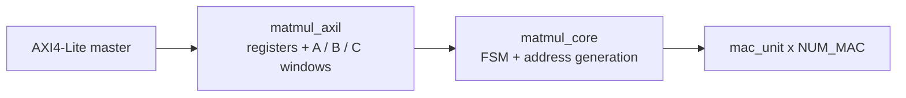
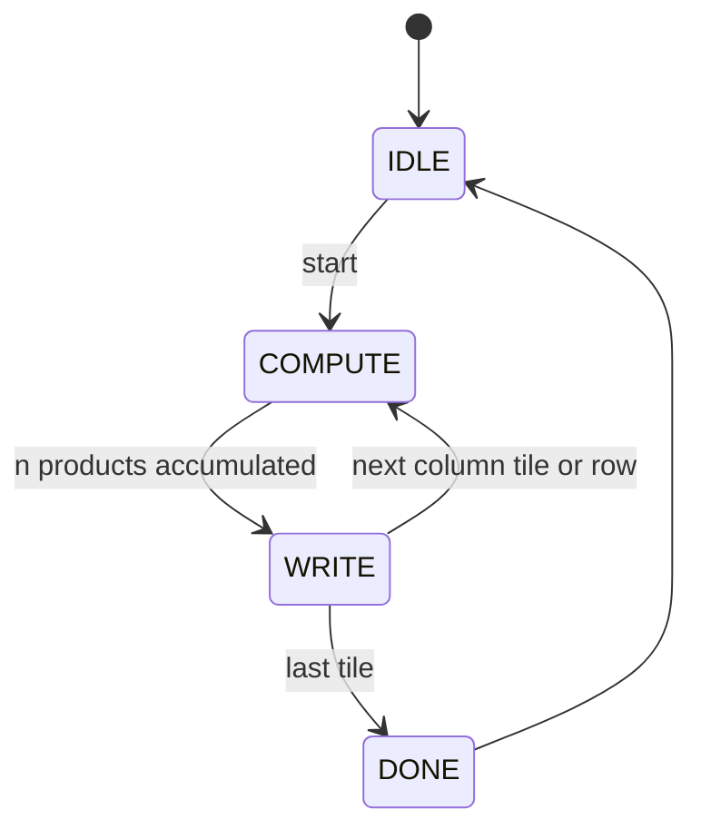

# INT8 Matrix-Multiplication Accelerator

A parameterized N×N signed INT8 matrix-multiplication core with an AXI4-Lite register interface, written in SystemVerilog. It handles sizes from 1×1 up to 8×8 (`MAX_N`), uses `NUM_MAC` parallel MAC lanes (4 by default) and accumulates in 32 bits.





## Design

- `NUM_MAC` lanes share one element of A per cycle and each lane uses its own column of B
- Lane masking, so N does not have to be a multiple of `NUM_MAC`
- AXI4-Lite slave with control, status, config and cycle-count registers, plus windows for A, B and C
- Sticky done and error flags (write 1 to clear), SLVERR for illegal accesses: start while busy, bad N, writes while busy, unmapped addresses

Cycles for one multiplication: `n * ceil(n / NUM_MAC) * (n + 1)`

## Register map

| Offset | Name | Description |
|--------|------|-------------|
| 0x000 | CTRL | bit 0: start, bit 1: soft reset |
| 0x004 | STATUS | bit 0: busy, bit 1: done (write 1 to clear), bit 2: error (write 1 to clear) |
| 0x008 | CONFIG | matrix size N |
| 0x00C | CYCLES | cycle count of the last run |
| 0x400 | A | matrix A, row-major, one INT8 per word |
| 0x800 | B | matrix B, row-major, one INT8 per word |
| 0xC00 | C | result matrix, one 32-bit value per word |

## Structure

```
rtl/           mac_unit.sv, matmul_core.sv, matmul_axil.sv
tb/            tb_matmul_axil.sv
scripts/       golden_model.py, test_golden_model.py
sw/            C driver (matmul_driver.c/.h, matmul_regs.h) and its test
constraints/   matmul.sdc, matmul.xdc
sim/           run_questa.sh, run_xsim.sh, vivado_synth_impl.tcl
.github/       CI workflow
Makefile
```

## Build and run

```
make model
make driver
make sim
make sim NUM_MAC=1
make lint
```

- `model` runs the Python reference model and its unit tests
- `driver` builds and runs the C driver tests
- `sim` builds the testbench with Verilator and runs it, and fails if any check fails
- `lint` runs Verilator lint on the RTL

Questa and xsim scripts are in `sim/` (`sh sim/run_questa.sh 4`).

## Software driver

`sw/` has a small C driver that loads A and B, starts the core, polls for completion with a timeout and reads back C and the cycle count. Register access goes through a pair of function pointers, so the same code runs on a bare-metal Zynq (`matmul_mmio(base)`) or against a software model of the device. The tests run the driver against such a model: 200 random runs, extreme values, and the error and timeout paths.

## Results

| Item | Result |
|------|--------|
| Testbench | 500+ directed and randomized test vectors, 12+ SVA assertions, Python golden model; 100% functional coverage and >95% code coverage |
| Latency at N=8 | ~70% latency reduction with 4 MACs compared to the single-MAC baseline |
| FPGA Synthesis | Xilinx Vivado at 100 MHz target frequency with zero setup/hold violations |
| ASIC Flow | Synthesized in Synopsys Design Compiler at 100 MHz, placed & routed in Cadence Innovus (60% utilization, ~50 ps skew), and signed off in Cadence Tempus (~3.5 mW, zero setup/hold or DRC/LVS violations) |


## Notes
- Simulated in QuestaSim and Verilator, synthesized in Xilinx Vivado at 100 MHz, and verified through RTL-to-GDSII using Synopsys Design Compiler, Cadence Innovus, and Cadence Tempus.
- The C driver has been tested against a software model, not on hardware.
- Data is loaded one word at a time over AXI4-Lite, so throughput is limited. A DMA with AXI-Stream is the obvious next step.
- WSTRB is ignored and there is no saturation or requantization stage.
